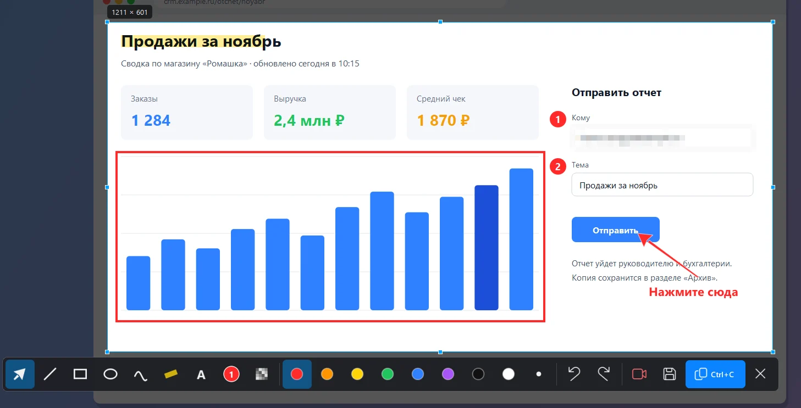
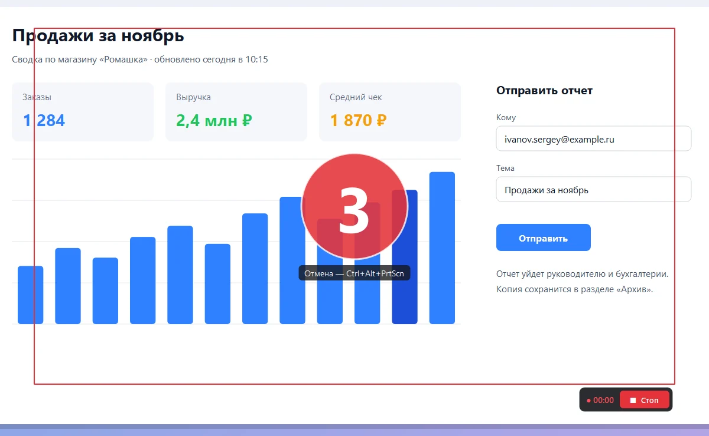
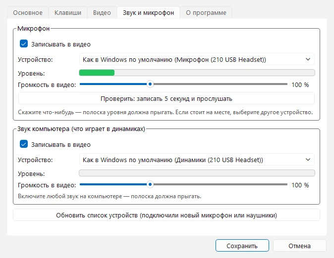

# Skrin — annotated screenshots and screen recording for Windows

[Русский](README.md) · **English**

A free, open-source app. Press **PrtScn** → select an area → add an arrow, box, step number or text → press
**Ctrl+C**, and the screenshot is in your clipboard (and saved to a folder). When showing is easier than explaining,
**record your screen** with system audio and microphone to mp4.

No sign-up, no ads, no paid features. Your files stay on your computer.

> The user interface is in Russian for now. Translations are welcome — see [CONTRIBUTING.md](CONTRIBUTING.md).



## Download

- **Installer for Windows 10/11 (64-bit):** https://website18.ru/skrin/download/ — or from this repository's
  [Releases](../../releases) page (SHA-256 is listed there).
- Product page: https://website18.ru/skrin/
- No administrator rights required. Settings open on first launch.

> **Windows says "Windows protected your PC"?** That's how Windows treats apps without a paid code-signing
> certificate. Click "More info" → "Run anyway". If you'd rather not, build the installer yourself from this source
> (see below) — it takes a couple of commands.

## Features

**Screenshots**
- Select an area with the mouse or click a window/screen; works across multiple monitors, 4K and 125–200 % scaling.
- Arrows, lines, rectangles, ellipses, pen, translucent highlighter, outlined text, step numbers 1-2-3, pixelate blur
  (hide an email or password).
- 8 colors, 4 sizes (mouse wheel — even for the annotation you just drew), Shift — exact 45° / square / circle.
- Move, recolor and delete annotations; unlimited undo/redo (Ctrl+Z / Ctrl+Y).
- Ctrl+C or Enter — copy to clipboard + save PNG/JPG to a folder; Ctrl+S — "Save as…".
- **Editor window** ("Open in editor" button or O): the screenshot in a normal window — keep it next to your work,
  "always on top", zoom, the same annotations, Ctrl+C without closing. Can open right after selecting (settings),
  an image file or the clipboard (tray menu).

**Video**
- Area, window or full monitor; system audio and microphone with separate volume.
- 3-2-1 countdown; the red frame and the "Stop" button are visible to you but never recorded.
- mp4 (H.264), encoded by NVIDIA (NVENC) or AMD (AMF) GPUs, or by the CPU (x264) otherwise.
- After recording — "Open folder" / "Watch video". Nothing is uploaded.

**Settings**
- Folders for screenshots and videos, PNG/JPG, custom hotkeys.
- Microphone and speaker selection, live level meter, "record 5 seconds and play back".
- 15–60 fps, three quality levels, start with Windows, one-click updates.

| | |
|---|---|
|  |  |

## Hotkeys

| Key | Action |
|---|---|
| PrtScn | select an area and annotate (configurable) |
| Ctrl+Alt+PrtScn | start video recording; press again to stop |
| Ctrl+C / Enter | copy to clipboard and save to folder |
| Ctrl+S | save as |
| Ctrl+Z / Ctrl+Y | undo / redo |
| A L R E P M T N B | arrow, line, rectangle, ellipse, pen, highlighter, text, number, blur |
| 1–8 · mouse wheel | color · size |
| V | record video of the selected area |
| O | open the selection in the editor window |
| Ctrl+wheel · Ctrl+0 · Ctrl+1 | in the editor: zoom · fit to window · 100 % |
| Esc | close |

Yandex Browser can also take screenshots on PrtScn, so both apps react to one key press. Skrin warns about it,
and a checkbox in Settings → Hotkeys turns the browser's hotkeys off.

## What the app sends over the internet

Fully disclosed:
- every 6 hours it reads `https://website18.ru/skrin/latest.json` to check for a new version
  (can be turned off in "Settings → About");
- when updating, it downloads the new installer and verifies its SHA-256;
- a support message — **only when you send one yourself** (and the log only if you leave the checkbox on).

Screenshots, videos, audio and screen contents are never sent anywhere.

## Build it yourself

Requirements: Windows 10/11, Python 3.12+, [Inno Setup 6](https://jrsoftware.org/isdl.php) (installer only).

```powershell
git clone https://github.com/q115234/skrin.git
cd skrin
python -m pip install PySide6 PyAudioWPatch pyinstaller Pillow
powershell -ExecutionPolicy Bypass -File tools\get-ffmpeg.ps1   # ffmpeg.exe -> bin\
pythonw skrin.pyw                                                # run from source
powershell -ExecutionPolicy Bypass -File build.ps1               # installer -> dist\SkrinSetup-<version>.exe
```

Your own build will check for updates and send support messages to website18.ru — change `SITE_URL` in
[config.py](config.py) if you want your own server.

## How it works

| File | Purpose |
|---|---|
| [skrin.pyw](skrin.pyw) | tray icon, global hotkeys, single instance, popups, updates |
| [overlay.py](overlay.py) | full-desktop selection and annotation window |
| [shapes.py](shapes.py) | annotations: drawing, hit testing, moving |
| [recorder.py](recorder.py) | video: ffmpeg `ddagrab` (Desktop Duplication) + NVENC/AMF/x264, audio mixing |
| [audio.py](audio.py) | WASAPI audio: devices, wav capture, level meter |
| [settings.py](settings.py) · [support.py](support.py) · [updater.py](updater.py) | settings · support · updates |
| [winapi.py](winapi.py) | RegisterHotKey, window list, DXGI outputs, hiding the recording frame from capture |
| [build.ps1](build.ps1) · [build/skrin.iss](build/skrin.iss) | PyInstaller build + Inno Setup installer |
| [site/support.php](site/support.php) | server-side support message handler |

## Authors

- [Website18](https://website18.ru) ([@q115234](https://github.com/q115234)) — the app;
- [@7xz7](https://github.com/7xz7) — editor window, clearer blur tool.

## Contributing

Found a bug or have an idea — [open an issue](../../issues/new/choose). Want to fix it yourself — fork and send a
pull request, see [CONTRIBUTING.md](CONTRIBUTING.md). Changelog — [CHANGES.md](CHANGES.md) (in Russian).

## License

Source code — [MIT](LICENSE): use, modify and redistribute freely, including in your own projects.
The installer bundles FFmpeg (GPL v3), Qt/PySide6 (LGPL v3) and other components — see [THIRD_PARTY.md](THIRD_PARTY.md).

Made by the [Website18](https://website18.ru) web studio for the students of our learning projects and for anyone
who finds it useful.
