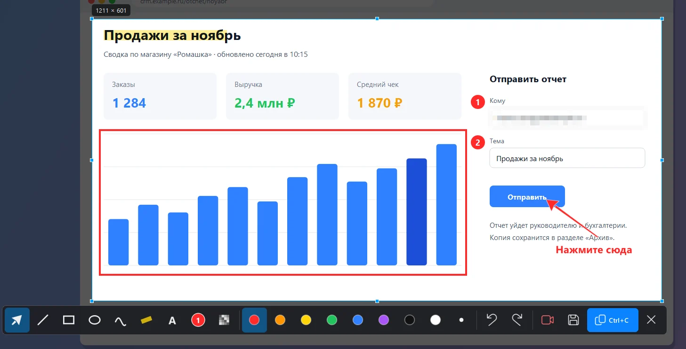
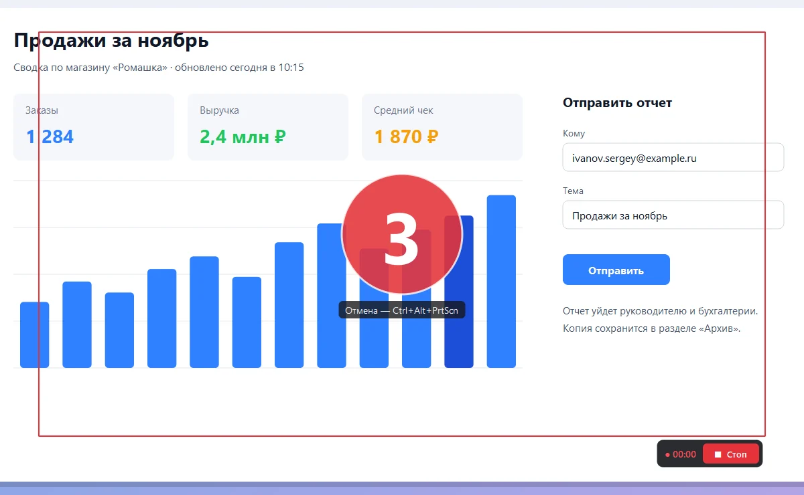
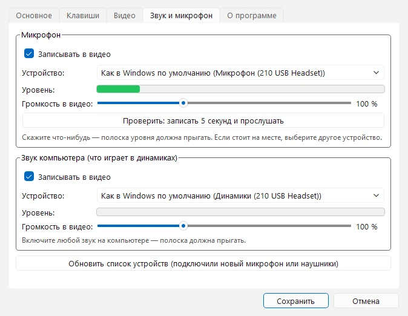

# Скрин — скриншоты с пометками и запись экрана для Windows

**Русский** · [English](README.en.md)

Бесплатная программа с открытым кодом. Нажали **PrtScn** → выделили область → поставили стрелку, рамку, номер или текст →
**Ctrl+C** — и скриншот уже в буфере обмена (и в папке). А если проще показать, чем объяснить, — **запись видео экрана**
со звуком компьютера и микрофоном в mp4.

Без регистрации, без рекламы, без платных функций. Файлы сохраняются только у вас на компьютере.



## Скачать

- **Установщик для Windows 10/11 (64 бита):** https://website18.ru/skrin/download/ — или со страницы
  [Releases](../../releases) этого репозитория (там же SHA-256 файла).
- Страница программы: https://website18.ru/skrin/
- Права администратора для установки не нужны. При первом запуске откроются настройки.

> **Windows пишет «Система Windows защитила ваш компьютер»?** Так Windows встречает программы без платной
> цифровой подписи. Нажмите «Подробнее» → «Выполнить в любом случае». Не доверяете — соберите установщик сами
> из этого кода (ниже), это пара команд.

## Что умеет

**Скриншоты**
- Выделение области мышью или щелчок по окну/экрану; работает на нескольких мониторах, 4K и масштабе 125–200 %.
- Стрелки, линии, рамки, овалы, карандаш, полупрозрачный маркер, текст с обводкой, номера шагов 1-2-3, размытие
  (спрятать почту или пароль).
- 8 цветов, 4 толщины (колесом мыши — даже у только что нарисованной пометки), Shift — ровно 45° / квадрат / круг.
- Пометки можно двигать, перекрашивать, удалять; отмена и повтор (Ctrl+Z / Ctrl+Y).
- Ctrl+C или Enter — в буфер обмена + файл PNG/JPG в папку; Ctrl+S — «Сохранить как…».
- **Окно редактора** (кнопка «Открыть в редакторе» или O): скриншот в обычном окне — смотреть рядом с другой
  работой, «поверх всех окон», масштаб, те же пометки, Ctrl+C без закрытия окна. Можно открывать сразу после
  выделения (настройки), картинку из файла или из буфера обмена (меню значка).

**Видео**
- Область, окно или весь монитор; звук компьютера и микрофон, громкость каждого настраивается.
- Отсчёт 3-2-1, красная рамка и кнопка «Стоп» — их видно вам, но в видео они не попадают.
- mp4 (H.264); сжимает видеокарта NVIDIA (NVENC) или AMD (AMF), без неё — процессор (x264).
- После записи — «Открыть папку» / «Смотреть видео». Видео никуда не загружается.

**Настройки**
- Папки для скриншотов и видео, формат PNG/JPG, свои горячие клавиши.
- Выбор микрофона и динамиков, живая шкала уровня, «записать 5 секунд и прослушать».
- Плавность 15–60 кадров/с, три уровня качества, автозапуск, обновления в один щелчок.

| | |
|---|---|
|  |  |

## Горячие клавиши

| Клавиша | Действие |
|---|---|
| PrtScn | выделить область и рисовать (меняется в настройках) |
| Ctrl+Alt+PrtScn | запись видео; повторно — стоп |
| Ctrl+C / Enter | в буфер обмена и в папку |
| Ctrl+S | сохранить как |
| Ctrl+Z / Ctrl+Y | отменить / вернуть |
| A L R E P M T N B | стрелка, линия, рамка, овал, карандаш, маркер, текст, номер, размытие |
| 1–8 · колесо мыши | цвет · толщина |
| V | записать видео выделенной области |
| O | открыть выделенное в окне редактора |
| Ctrl+колесо · Ctrl+0 · Ctrl+1 | в редакторе: масштаб · по размеру окна · 100 % |
| Esc | закрыть |

## Что программа отправляет в интернет

Честно и полностью:
- раз в 6 часов читает `https://website18.ru/skrin/latest.json`, чтобы узнать, не вышла ли новая версия
  (можно выключить: «Настройки → О программе»);
- при обновлении скачивает новый установщик и проверяет его SHA-256;
- сообщение в поддержку — **только когда вы сами его отправляете** (и журнал — только если оставите галочку).

Скриншоты, видео, звук и содержимое экрана никуда не отправляются.

## Собрать самому

Нужно: Windows 10/11, Python 3.12+, [Inno Setup 6](https://jrsoftware.org/isdl.php) (только для установщика).

```powershell
git clone https://github.com/q115234/skrin.git
cd skrin
python -m pip install PySide6 PyAudioWPatch pyinstaller Pillow
powershell -ExecutionPolicy Bypass -File tools\get-ffmpeg.ps1   # ffmpeg.exe → bin\
pythonw skrin.pyw                                                # запустить из исходников
powershell -ExecutionPolicy Bypass -File build.ps1               # установщик → dist\SkrinSetup-<версия>.exe
```

Своя сборка будет проверять обновления и отправлять сообщения поддержки на website18.ru — поменяйте `SITE_URL`
в [config.py](config.py), если хотите своё.

## Как устроено

| Файл | Что делает |
|---|---|
| [skrin.pyw](skrin.pyw) | трей, горячие клавиши, одна копия программы, окошки, обновления |
| [overlay.py](overlay.py) | окно выделения и рисования поверх всех мониторов |
| [editor.py](editor.py) | окно редактора: тот же холст (Overlay) в обычном окне, масштаб, «поверх всех окон» |
| [shapes.py](shapes.py) | пометки: отрисовка, попадание мышью, перемещение |
| [recorder.py](recorder.py) | видео: ffmpeg `ddagrab` (Desktop Duplication) + NVENC/AMF/x264, сведение звука |
| [audio.py](audio.py) | звук WASAPI: устройства, запись в wav, шкала уровня |
| [settings.py](settings.py) · [support.py](support.py) · [updater.py](updater.py) | настройки · поддержка · обновления |
| [winapi.py](winapi.py) | RegisterHotKey, список окон, мониторы DXGI, скрытие рамки записи от захвата |
| [build.ps1](build.ps1) · [build/skrin.iss](build/skrin.iss) | сборка PyInstaller + установщик Inno Setup |
| [site/support.php](site/support.php) | приём сообщений поддержки на сервере |

## Участие

Нашли ошибку или есть идея — [создайте issue](../../issues/new/choose). Хотите поправить сами — сделайте fork и
pull request, подробности в [CONTRIBUTING.md](CONTRIBUTING.md). Что менялось — [CHANGES.md](CHANGES.md).

## Лицензия

Код — [MIT](LICENSE): можно использовать, менять и распространять, в том числе в своих проектах.
Установщик включает FFmpeg (GPL v3), Qt/PySide6 (LGPL v3) и другие компоненты — см. [THIRD_PARTY.md](THIRD_PARTY.md).

Сделано в веб-студии [Website18](https://website18.ru) для учеников наших учебных проектов —
[Учебный компьютер](https://pc.key-rpg.ru/), [Кибершкола](https://кибершкола18.рф/), [Key RPG](https://key-rpg.ru/),
[AstroType](https://astrotype.key-rpg.ru/) — и для всех, кому пригодится.
